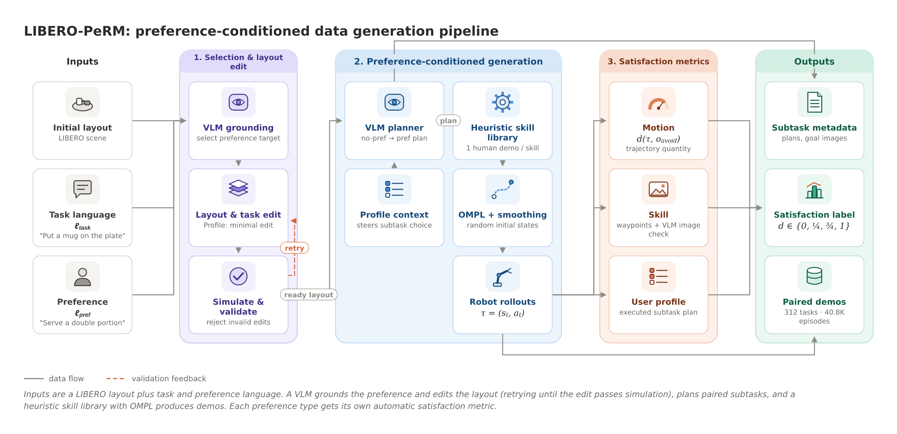
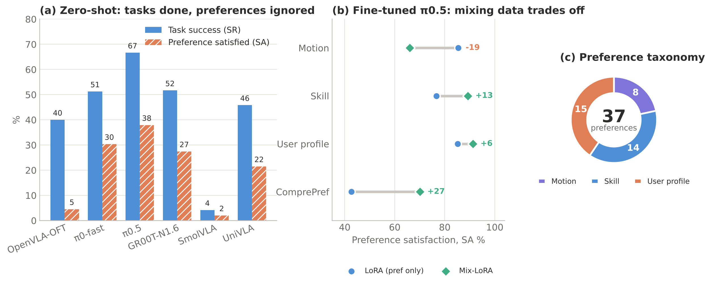
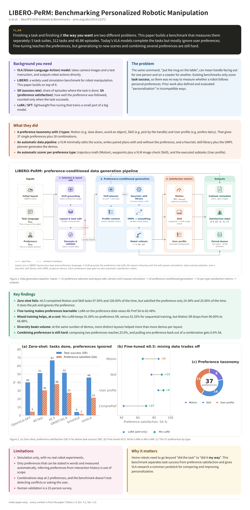

# make-paper-easy

**Paper link in → paper you actually understand out.** Exact figures, real numbers, zero API keys.

An [Agent Skill](https://docs.claude.com/en/docs/agents-and-tools/agent-skills/overview) that turns a research paper into something an undergraduate can actually follow.

Give it a PDF, a PDF link, or a paper webpage (e.g. arXiv), and it:

1. **Converts the paper to Markdown** with [MarkItDown](https://github.com/microsoft/markitdown) and hands you the `.md` file.
2. **Writes an undergrad-friendly summary**: TL;DR, background terms explained, the problem, the method, key findings with the paper's real numbers, and limitations.
3. **Visualizes what helps**: a PaperBanana-style method diagram and multi-panel results charts, using only symbols and values printed in the paper. The agent renders each figure, looks at it, and fixes overlaps or errors before sending it.




*Both figures are generated by the skill for [LIBERO-PeRM](https://arxiv.org/abs/2610.22372), with no image-model API and no cost.*

## Install

**Easiest:** paste this into Claude Code (or Codex / Cursor):

```
Please install the make-paper-easy skill from https://github.com/<your-username>/make-paper-easy
```

**Or with the skills CLI:**
```bash
npx skills add <your-username>/make-paper-easy
```

**Or by hand (Claude Code):**
```bash
git clone https://github.com/<your-username>/make-paper-easy.git ~/make-paper-easy
mkdir -p ~/.claude/skills
ln -s ~/make-paper-easy/skills/make-paper-easy ~/.claude/skills/make-paper-easy
pip install 'markitdown[pdf]' resvg-py pillow matplotlib
```

**Claude.ai / Claude app:** zip the `skills/make-paper-easy/` folder and upload it under **Settings → Capabilities → Skills**.

## Use

```
/make-paper-easy https://arxiv.org/abs/2610.22372
/make-paper-easy ~/Downloads/paper.pdf
/make-paper-easy <link> in Spanish   # English by default
```

You get **one study sheet**, `make-paper-easy/<paper>/<paper>-easy.png` (plus a PDF), with everything in reading order:
TL;DR → background terms → the problem → what they did → method diagram → key findings → results charts → limitations.

The parts are saved next to it, in case you want them: `paper.md` (the full paper), `summary.json`, and `figure`/`results` as both PNG and editable SVG.

<p align="center"></p>

### How figures are made (free)

- **Method diagrams** (`compose_diagram.py`): tinted modules, small nodes with built-in icons, math labels like `π_θ` and `ℒ_KL`, merging and feedback arrows, and a legend. Every label is real SVG text, so it's always exact. This needs no API key.
- **Results charts** (`plot_style.py`): a matplotlib theme for paper-style multi-panel charts, with grouped bars, dumbbells and donuts.
- **Optional illustrated art**: small thumbnails for diagram nodes, or large art for simple card figures (`compose_figure.py`). An image model draws only text-free pieces, which are composited into the SVG.

The optional art comes from FLUX on Cloudflare Workers AI's free tier, roughly 100–170 images a day:

1. Create a free account at [dash.cloudflare.com](https://dash.cloudflare.com).
2. Go to **AI → Workers AI → Use REST API**. Copy the **Account ID**, then click **Create a Workers AI API Token** and copy the token.
3. Save them on your computer. On macOS with zsh, `read -s` keeps the token out of your shell history:
   ```bash
   echo 'export CF_ACCOUNT_ID="your_account_id"' >> ~/.zshrc
   read -s "tok?Paste token: "; echo "export CF_API_TOKEN=\"$tok\"" >> ~/.zshrc; unset tok
   source ~/.zshrc
   pip install resvg-py pillow
   ```

Without Cloudflare credentials, diagrams use icons instead of thumbnails.

To try the bundled examples:
```bash
python skills/make-paper-easy/scripts/compose_diagram.py examples/libero-perm-dense/spec.json   # dense diagram
python examples/libero-perm-dense/results_plot.py                                         # results charts
python skills/make-paper-easy/scripts/flux_art.py examples/libero-perm/spec.json                 # card figure art
python skills/make-paper-easy/scripts/compose_figure.py examples/libero-perm/spec.json
```

### Optional: publication-style figures with PaperBanana

PaperBanana makes single-image, fully painted diagrams using Gemini or OpenAI image models. It's paid, roughly $0.40 per diagram. For polished, paper-style figures, enable the [PaperBanana](https://github.com/dwzhu-pku/PaperBanana) backend:

```bash
pip install 'paperbanana[pdf]'
export GOOGLE_API_KEY=...        # or OPENAI_API_KEY / OPENROUTER_API_KEY
paperbanana doctor               # confirm it's ready
```

Then ask: "Explain this paper and use PaperBanana for the figures."

A diagram costs roughly $0.40 at default settings, and each figure is capped at $1. Check before running with:

```bash
python skills/make-paper-easy/scripts/pb_figure.py diagram method.txt "Overview of the method" fig.png --cost-only
```

## Repo layout

```
skills/make-paper-easy/
├── SKILL.md               # instructions the agent follows
└── scripts/
    ├── convert.py         # PDF/URL → Markdown via MarkItDown
    ├── compose_diagram.py # spec.json → dense PaperBanana-style method diagram (SVG + PNG)
    ├── plot_style.py      # paper-style matplotlib theme for results charts
    ├── make_sheet.py      # summary.json + figures → ONE study-sheet PNG/PDF
    ├── compose_figure.py  # spec.json → simple card figure with large art
    ├── flux_art.py        # text-free art pieces via Cloudflare FLUX (free tier)
    ├── gemini_prompt.py   # spec.json → prompt for the free Gemini app
    └── pb_figure.py       # optional paid PaperBanana backend
examples/
├── libero-perm-dense/     # dense diagram spec + results chart script (LIBERO-PeRM, arXiv 2610.22372)
└── libero-perm/           # simple card figure spec
```

## Credits

- [MarkItDown](https://github.com/microsoft/markitdown) (Microsoft, MIT) for PDF/HTML → Markdown.
- [FLUX.1 schnell](https://developers.cloudflare.com/workers-ai/models/flux-1-schnell/) (Black Forest Labs, via Cloudflare Workers AI) for art pieces; [resvg](https://github.com/linebender/resvg) for SVG rendering.
- [PaperBanana](https://github.com/dwzhu-pku/PaperBanana) (Zhu et al., arXiv:2601.23265, Apache-2.0) for the multi-agent figure method. This skill calls the [`paperbanana`](https://pypi.org/project/paperbanana) package, an unofficial MIT-licensed implementation by llmsresearch. Neither project's code is included here; both are installed separately.

## Notes

- Scanned (image-only) PDFs yield no text; run OCR first.
- Some sandboxed environments block downloads from arbitrary URLs. For arXiv the skill falls back to the paper's HTML page; otherwise, attach the PDF.

## License

MIT. See [LICENSE](LICENSE).
